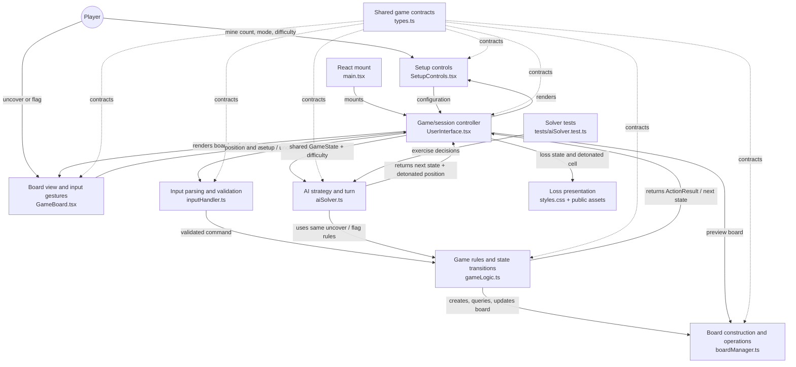
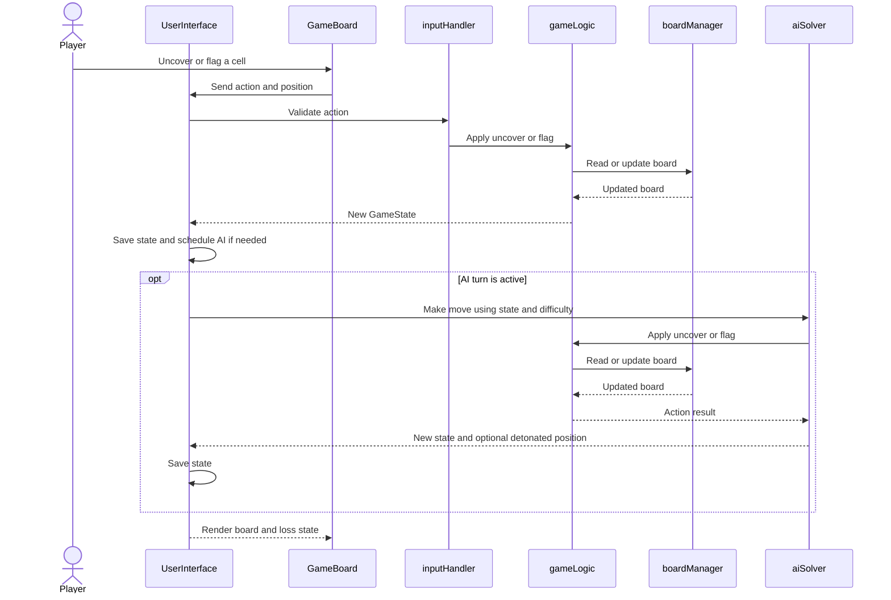

# Current System Architecture

This document describes the current Project 2 system. See [Original-Architecture.md](./Original-Architecture.md) for the inherited design. The game uses React, TypeScript, and Vite.

## System overview

`UserInterface` owns the game state and renders the game. Player and AI actions use the same game rules and board. `boardManager` handles board creation and cell operations.

The board is 10 × 10 with 10–20 mines. The first reveal clears the clicked cell and its neighbors by relocating mines, updating clues, and opening the connected safe area.

## Component responsibilities

| Component | Role |
|---|---|
| `src/main.tsx` | Starts the React app. |
| `src/UserInterface.tsx` | Owns game state, handles actions and AI turns, and shows game status and loss feedback. |
| `src/components/SetupControls.tsx` | Collects mine count, play mode, and AI difficulty. |
| `src/components/GameBoard.tsx` | Displays the board and sends uncover/flag actions to the interface. |
| `src/inputHandler.ts` | Validates setup and cell inputs, including references such as `B5`. |
| `src/gameLogic.ts` | Starts games and applies reveal, flag, win, and loss rules. |
| `src/boardManager.ts` | Creates and updates boards, checks positions, and manages mines and neighbors. |
| `src/aiSolver.ts` | Implements Easy, Medium, and Hard AI moves using shared game rules. |
| `src/interactiveAI.ts` | Re-exports the solver API for compatibility. |
| `src/types.ts` | Defines shared game constants and data types. |
| `src/styles.css`, `public/boom.png`, `public/vineBoom.mp3` | Style the game and provide loss effects. |
| `tests/aiSolver.test.ts` | Tests AI rules, fallback, terminal states, and loss reporting. |

## Component and dependency diagram

## Data model and state ownership

`UserInterface` owns the active `GameState`. Game operations return new state values, which the UI passes to display components.

- **`Position`** is a row and column.
- **`Cell`** stores mine status, adjacent mine count, and visibility.
- **`Board`** is a two-dimensional array of cells.
- **`GameState`** stores the board, mine and flag counts, revealed-safe count, first-reveal status, and game status.
- **`ActionResult`** returns an updated state or an input error.
- **`RandomSource`** makes random choices replaceable in tests.
- **AI types** define play modes, difficulty, and move results (state plus optional detonated position).

The board manager handles board operations. The UI also tracks mode, difficulty, AI scheduling, errors, and the detonated cell.

## Gameplay and AI turn flow

1. The player selects mine count, mode, and difficulty. The UI validates the setup and starts a game.
2. The board manager places mines and calculates clue numbers.
3. The board sends uncover or flag actions to the UI. The input handler validates them and calls the game rules.
4. The first reveal protects the clicked cell and neighbors, then opens the connected safe area. Later reveals use flood fill without moving mines.
5. Flags are limited to the mine count but can always be removed. Revealing all safe cells wins; hitting a mine loses and exposes mines.
6. **Player only** mode has no AI turns. **Player + AI** schedules one AI move after each changed player action. **AI solves board** repeats AI turns until stopped or the game ends.
7. Easy picks a random covered cell. Medium uses clue-based flag/reveal rules, then random fallback. Hard tries the 1-2-1 rule before Medium rules and fallback. All AI actions use shared game rules.
8. The game rules or solver returns the next state to the UI, which re-renders the board.

## Loss feedback

Player and AI losses use `gameLogic.ts`. On loss, the UI records the detonated cell, plays `public/vineBoom.mp3`, reveals the mines, shows `public/boom.png`, and shakes the panel. The same UI path handles either actor.

The feature's event sequence is also documented in [new-feature-uml.md](./new-feature-uml.md).

## Quality checks and extension points

Run `npm test` for solver tests, `npm run typecheck` for TypeScript checks, and `npm run build` for typechecking and a production build. Add AI strategies through the solver and shared game rules; keep game rules out of UI components.
