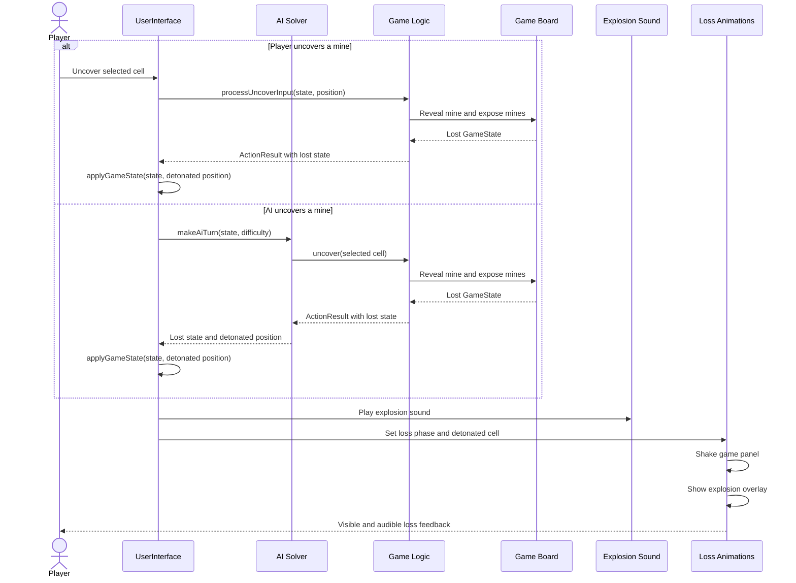

<!--
Document: UML sequence diagram for the Project 2 loss-effect custom feature.
Inputs: Loss events caused by player or AI uncover actions.
Outputs: Model of detonated-cell state, explosion sound, panel shake, and overlay.
UI attribution: Alica Mungamuri & Audrey Facer.
User-versus-AI attribution: Lilly Tran & Heidi Schieber.
Automatic-solving attribution: Zain Cheema and Ibaad Khatib.
External sources: Current project implementation and Project 2 requirements;
OpenAI Copilot assisted with documentation and diagram authoring.
Created: 2026-10-10
-->
# Loss-Effect Feedback UML

This sequence diagram models the Project 2 custom feature: consistently communicating a loss with a sound effect, a shaking game panel, and an explosion animation for losses caused by either the player or the AI.

